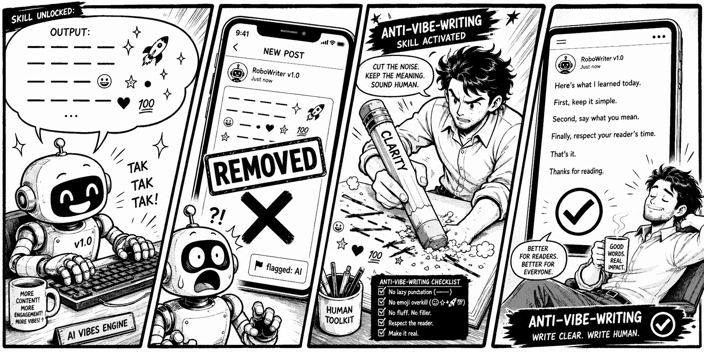

# anti-vibe-writing



[](./README.md)
[](./README.zh.md)
[](./LICENSE)
[](./CHANGELOG.md)

> 本 README 提供中英文两个版本：**English**（本页，默认）和 **[中文](./README.zh.md)**。点上方徽章切换。

> **One goal: make AI sound genuinely idiomatic, 倍儿地道.**

An agent writing skill that removes the AI-generated feel from documents. Works in English and Chinese, with optional modes for matching a specific author's voice.


<sub>A real pair from [`examples/03-tweet.md`](./examples/03-tweet.md). More in [examples/](./examples/).</sub>

It runs best as a final pass after drafting with Claude Code, Codex, or any LLM-backed agent. Its job is to keep the substance and remove the tells: templated phrasing, vague abstraction, consultant-speak, markdown-heavy formatting, over-structured outlines, the copy-paste residue chat and search models leave behind (`oaicite` / `turn0search0` / `[cite: 1]` / stray `【】` markers), and the cautious over-balancing that makes writing feel assembled.

If the default "clean" mode is not enough, the skill also supports:
- **Human-texture mode**: inject controlled irregularities (inversions, particles, half-sentences, non-standard punctuation) for personal voice
- **Learning mode**: build a reusable host profile from real samples so future drafts sound like the person who would write them
- **Scenario presets**: format and tone constraints tuned for tweets, Weibo, blogs, podcast show notes, and professional reports

## Quick start

At its core this is just a set of markdown rules (`SKILL.md` + `references/` + `assets/`), not tied to any one agent. Claude Code, Codex, Kimi, work-buddy, Hermes. If it can read files or take an instruction prompt, it can use this.

**Claude Code, one step:**

```text
/plugin install anti-vibe-writing --marketplace weijt606/anti-vibe-writing
```

Then call `/anti-vibe-writing`, or just ask Claude to de-AI a draft. On Claude Code older than 2.1.275, run `/plugin marketplace add weijt606/anti-vibe-writing` first, then `/plugin install anti-vibe-writing@anti-vibe-writing`.

**Codex, Cursor, Gemini CLI and other agents, one step with the GitHub CLI** (gh 2.90 or newer):

```bash
gh skill install weijt606/anti-vibe-writing anti-vibe-writing --agent codex --scope user
```

Swap `codex` for `cursor`, `gemini-cli`, `claude-code`, `opencode` or any other name in `gh skill install --help`. It installs the latest release, and `gh skill update` pulls newer ones later. No GitHub CLI? Follow the three steps below.

**1. Get the rules**

Clone the repo, or just copy the `skills/anti-vibe-writing/` folder:

```bash
git clone https://github.com/weijt606/anti-vibe-writing.git
```

**2. Feed it to your agent (pick whichever fits)**

- **Simplest: just hand it the repo link.** No need to clone first: send `https://github.com/weijt606/anti-vibe-writing` and let the agent read `SKILL.md` and `references/` and configure itself. Works with any agent that can browse the web or run git.
- **One-off (any agent)**: open `skills/anti-vibe-writing/assets/rewrite-prompt-template.md`. It has ready-made instruction blocks: Full Rewrite / Light Cleanup in English, and "中文改写（带负向约束）" for Chinese. Copy the block for your language and send it with your draft.
- **Persistent**: put `SKILL.md` and the matching `references/*patterns-to-remove.md` wherever your agent loads context. Names differ by tool:
  - Agents with a skills directory (e.g. Claude Code): drop it in `~/.claude/skills/anti-vibe-writing/`, then call `/anti-vibe-writing`
  - Agents with a project-instructions file (e.g. Codex's `AGENTS.md`): write or include the rules there
  - Otherwise: paste into the system prompt / custom instructions / knowledge base

**3. (Optional) Name the scenario and mode**

One line of context changes the result a lot:
- Scenario: "this is a tweet / a newsletter / a technical memo"
- Loosen up: "make it feel personal" / "blog voice" → enables human-texture mode
- Match a voice: paste a few of your own samples and say "learn my style" → enables learning mode

When in doubt, say nothing. The default clean mode is right for most drafts.

## Quick examples

Curated before/after snippets live in [examples/](./examples/) for anyone scanning the repo. The full regression set stays under `references/`.

## Voice modes

The skill runs in one of three modes:

| Mode | When to use | Triggered by |
|---|---|---|
| Default (clean) | Most product, docs, and professional copy | Default, no opt-in needed |
| Human texture | Personal blogs, founder notes, social posts | "Loosen it up" / "blog voice" / "make it feel personal" |
| Learning mode | Series content, personal newsletters, voice-consistent comms | User provides samples, or asks "learn my style" |

Modes combine with scenario presets (tweet / Weibo / blog / podcast / report). Conflict resolution rules are documented in `SKILL.md`.

Human-texture mode also has a **social-only "casual typing" (随手打) layer** (off by default; turn it on by naming it, "casual typing" / "开随手打", or describing the effect, "like a quick phone post"; matched by intent, not a fixed phrase, and a plain "loosen it up" won't trigger it): a tiny amount of phone-typing texture on casual posts (dropped end punctuation, no capitalization, an omitted particle) that **never touches numbers, names, or links** and never makes meaning-changing typos. It's phone-typing texture, not error injection to dodge AI detectors.

## Use cases

**The flagship case: Chinese posts on X.** Chinese AI-smell is most obvious on X: 赋能 / 打通, 首先 / 其次, three-clause parallelism, and machine-translation syntax give it away at a glance. This skill is built for exactly that: take an "obviously AI-written" Chinese post and make it read like something a person actually typed. See [`examples/07-tweet-zh.md`](./examples/07-tweet-zh.md) and [`examples/08-translationese-zh.md`](./examples/08-translationese-zh.md).

Other common cases:

- Social posts (X, Weibo, Jike, RedNote)
- Blogs, newsletters, public WeChat articles
- Podcast show notes and video scripts
- README cleanup
- Product docs and landing page copy
- Proposals, founder notes, technical memos, internal reports

## Output goals

- More human rhythm
- More intentional structure
- Cleaner phrasing
- Stronger voice
- Less AI smell
- Sounds like a person chose every word

## Repository layout

```text
.claude-plugin/
  plugin.json                              # Claude Code plugin manifest
  marketplace.json                         # lets `/plugin install` find it
agents/
  README.md
  anti-vibe-writing-dev.agent.md           # local, gitignored
  anti-vibe-writing-dev.agent.example.md
skills/
  anti-vibe-writing/
    SKILL.md
    references/
      patterns-to-remove.md                # English AI-smell
      chinese-patterns-to-remove.md        # 中文 AI 味
      before-after-benchmarks.md           # English benchmarks
      chinese-before-after.md              # 中文基准
      common-problems-and-fixes.md
      human-passes.md
      human-texture.md                     # Optional irregularity
      learning-mode.md                     # Sample-driven style learning
      scenario-presets.md                  # Per-scenario constraints
    assets/
      final-pass-checklist.md
      rewrite-prompt-template.md
      host-profile-template.md             # Fillable host profile
      style-extraction-prompt.md           # One-shot extraction prompt
examples/
  ...
scripts/
  check-own-prose.sh                       # CI: project prose passes its own rules
CHANGELOG.md
CONTRIBUTING.md
README.md                                    # English (default)
README.zh.md                                 # Chinese
LICENSE
```

## Working with the files

Skill files are versioned. The developer agent file is local and gitignored by default, so contributors can adjust it without changing the public repository.

To create a local agent file, copy `agents/anti-vibe-writing-dev.agent.example.md` to `agents/anti-vibe-writing-dev.agent.md`.

If you want tool-specific auto-discovery, you may still need to mirror these files into the locations required by the target agent platform.

## Credits & references

This skill stands on the shoulders of several open de-AI / humanizer projects and writeups. The patterns below were studied and adapted into this skill's own structure; the original analysis and wording belong to their authors. Thanks to:

English:
- [blader/humanizer](https://github.com/blader/humanizer): a 30-pattern humanizer skill (MIT). Informed the sentence-level tells: copula avoidance, negative parallelism, synonym cycling, false ranges, signposting, diff-anchored writing.
- [hardikpandya/stop-slop](https://github.com/hardikpandya/stop-slop): AI-slop detection skill (MIT). Source of the optional five-dimension scoring pass (Directness / Rhythm / Trust / Authenticity / Density) in `assets/final-pass-checklist.md`.

中文 / Chinese:
- [op7418/Humanizer-zh](https://github.com/op7418/Humanizer-zh): a 24-pattern Chinese humanizer skill, itself a Chinese adaptation of blader/humanizer (MIT). Informed the copula-"是" avoidance and synonym-cycling tells in the Chinese track.
- ["AI 中文翻译腔" by yage.ai](https://yage.ai/share/ai-chinese-translationese-20260418.html): the analysis of Chinese translationese (物理动作动词写抽象 / 形容词加冒号预判读者 / 抽象名词主语). Informed the 翻译腔层 of `references/chinese-patterns-to-remove.md`.
- [@dotey on X](https://x.com/dotey/status/2022774029220749538): discussion of de-AI prompt techniques (role-setting, negative constraints) that shaped the 改写心态 section and the Chinese rewrite prompt block.

AI-writing research (added in 1.9.0):
- [Wikipedia: Signs of AI writing](https://en.wikipedia.org/wiki/Wikipedia:Signs_of_AI_writing): the community-maintained catalog of AI-writing signs (October 2026 revision). Source of the mid-2026 vocabulary band, source-gap hedging, trailing participle analysis, placeholder and `utm_source` residue, the "Challenges and Future Outlook" ending, and the weak-evidence list.
- [Graphite's 2026 model-tell analysis, reported by TechCrunch](https://techcrunch.com/2026/10/01/opus-5-5-loves-to-tell-you-this-matters-and-other-ai-writing-tells/): per-model frequencies behind "this matters" / "why X matters", "dependable", the 2026 contrast-frame variants, and the em-dash decline.
- [《消除"罪证"：给写作去除"AI味"的不完全手册（2026版）》](https://eu.36kr.com/zh/p/3824601267196037) by 蒋雨恬, first published on the WeChat account 有三思 U Sense and reprinted by 36kr: informed 过度拔高, the "最" (豆包体) rule, 学术套话 openers, 虚假范围, and the note about people misjudged over two dashes.

These are independent projects and writeups with their own scope; this repo borrows their ideas and none of their code. If you maintain one of them and want a credit adjusted, open an issue.

## Contributing

See [CONTRIBUTING.md](./CONTRIBUTING.md) for how to add new patterns, benchmarks, or scenario presets.

## License

This project is open source under the MIT License. See `LICENSE`.

## Contributor notes

- Preserve meaning. Sharpen the writing without changing facts.
- Prefer concrete edits over generic style advice.
- Keep structure only when it helps the reader.

## What's new

**1.9.0**: catches up with how models write in late 2026 ("this matters", "not simply X", fewer em-dashes, Chinese 过度拔高 and "最" overuse, placeholders and tracking links), adds a list of features too weak to call a text AI-written on their own, and fixes places where the skill broke its own rules. Each version's full notes are in [Releases](https://github.com/weijt606/anti-vibe-writing/releases), and the whole history is in [CHANGELOG.md](./CHANGELOG.md).
